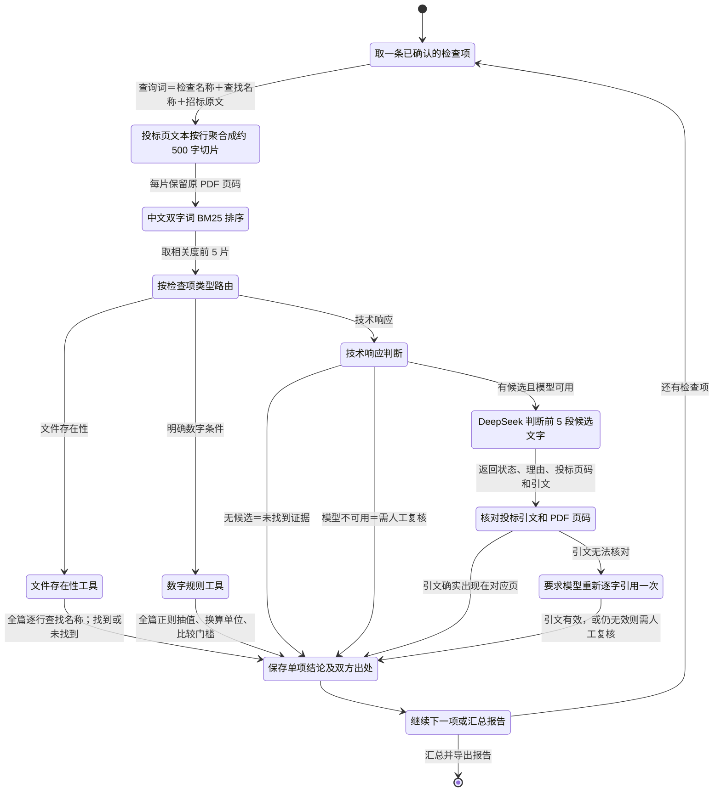

# BidTrace｜标尺

**Evidence-backed Bid Review Agent**：面向软件与信息化服务采购的投标文件提交前自查工具。上传招标文件与投标文件后，系统生成待确认的检查项，检索投标证据，并输出带双方原文与 PDF 页码的逐项报告。

项目将 DeepSeek 用于理解招标要求和辅助判断技术响应；文件存在性与明确数字条件交给程序校验。模型给出的引文须能在对应 PDF 页找到，无法核对的判断转入人工复核。

**技术栈：**Vue 3、FastAPI、SQLite、DeepSeek、pdfplumber、中文双字词 BM25。

## 核心 Agent 工作流

### 1. PDF 解析与检查项生成

```mermaid
stateDiagram-v2
    [*] --> Upload
    state "上传招标与投标 PDF" as Upload
    state "校验格式、大小与页数" as ValidatePDF
    state "拒绝文件并提示原因" as Reject
    state "pdfplumber 逐页提取文字" as ExtractPages
    state "页文本和文件记录写入 SQLite" as StorePages
    state "选择检查项来源" as SelectSource
    state "载入已标注演示检查项" as DemoChecks
    state "带 PDF 页码的招标全文送 DeepSeek" as ModelExtract
    state "校验招标引文和页码、去重" as CheckSource
    state "等待人工确认" as HumanGate
    state "开始逐项审核" as Run

    Upload --> ValidatePDF
    ValidatePDF --> Reject: 非 PDF、过大、超页数或文字不可提取
    Reject --> Upload: 重新选择文件
    ValidatePDF --> ExtractPages: 校验通过
    ExtractPages --> StorePages: 保留每页文字及物理页码
    StorePages --> SelectSource
    SelectSource --> DemoChecks: 演示模式
    SelectSource --> ModelExtract: 模型提取模式
    ModelExtract --> CheckSource: 返回候选检查项
    CheckSource --> HumanGate: 保留能在对应页找到招标原文的项目
    DemoChecks --> HumanGate
    HumanGate --> HumanGate: 核对原文、门槛，关闭不适用项
    HumanGate --> Run: 确认
```



### 2. 投标证据检索与单项判断



招标要求提取使用带页码的招标全文；约 500 字的切片只在投标证据检索时临时生成。BM25 候选段落用于定位证据；文件存在性与数字条件仍扫描投标全文。数字工具在抽不到明确数值时给出“未找到证据”，在同一字段出现不同承诺时给出“需人工复核”，其余情况按确认的门槛比较。引文校验只能证明文字存在于指定页，语义结论仍需使用者核对。

## 首版范围

面向投标人提交前自查，先处理软件与信息化服务采购的可提取文字 PDF。用户上传招标文件和投标文件后，模型提出检查项并标出招标原文；用户确认检查项；系统检索投标证据，程序比较明确数字，模型辅助判断技术响应；报告逐项给出“满足、明确冲突、未找到证据、需人工复核”和双方原文页码。首版使用 DeepSeek、FastAPI、Vue、SQLite。版本对比与扫描件识别不在本轮范围内。

## 真实来源与模拟样本

- 真实招标文件：[北京市政府采购项目《2025 年信息化城市管理运行》公开招标文件](https://csglw.beijing.gov.cn/zwxx/zbzb/zbxxx/202506/P020250626595469092921.pdf)。本地文件位于 `fixtures/source/`，共 70 个 PDF 物理页；`pdfplumber` 可正常提取中文。
- 招标文件 SHA-256：`F8DEA2AF389102C5611D317B4FCF7551CD3913890DC00B40B43F815A88F6E401`。页码统一按 PDF 物理页，从 1 开始；文件印刷页码与之不同。
- `fixtures/bids/模拟投标文件-符合样本.pdf`：6 页，10 项检查均设为满足。
- `fixtures/bids/模拟投标文件-问题样本.pdf`：6 页，2 项满足、6 项明确冲突、1 项未找到证据、1 项需人工复核。
- 两份投标文件纯属虚构，未模拟真实资质、签章或法律效力，不得用于实际投标。

## 10 项检查

检查项、来源原文、页码和两份投标文件的人工标准答案在 `fixtures/evaluation.json`。

| 类别 | 编号 | 检查内容 |
| --- | --- | --- |
| 文件存在性 | R01 | 投标书章节可找到 |
| 文件存在性 | R02 | 培训方案可找到 |
| 文件存在性 | R03 | 项目保障方案可找到 |
| 数字条件 | R04 | 投标总报价不超过 145 万元 |
| 数字条件 | R05 | 投标有效期不少于 90 日历天 |
| 数字条件 | R06 | 实施期限为一年 |
| 数字条件 | R07 | 可提供每周 7 天、每天 24 小时现场值守 |
| 数字条件 | R08 | 设置项目负责人 1 名 |
| 技术响应 | R09 | 每日含节假日监测并编制《综合信息》 |
| 技术响应 | R10 | 网格问题质量抽查、问题标记并形成日报 |

R02 和 R03 是评分材料，未找到只提示可能失分。R01 只检查章节文字是否可找到，不判断签名和盖章。数字条件必须先找到投标原文并确认单位，程序才比较数值。未找到证据不能推导为投标文件没有响应。

## 当前可运行流程

1. 上传可提取文字的招标 PDF 和投标 PDF，或载入内置演示样本。
2. 选择已标注的演示检查项，或在配置 DeepSeek 后从招标文件生成候选检查项。
3. 人工核对检查项的原文、页码和数字门槛，并决定哪些纳入本次审核。
4. 系统在投标 PDF 中检索候选证据；文件存在性与明确数字条件由程序判断，技术响应由 DeepSeek 辅助判断。
5. 逐项对照双方证据，打开原 PDF 定位页码，导出结构化 JSON 或打开可打印的 HTML 报告并保存为 PDF。

后端在 `backend/app/`，使用 FastAPI 与 SQLite；前端在 `frontend/`，使用 Vue。检索采用可检查的中文字符双字词 BM25 排序，数字字段另做全文精确扫描。模型返回的招标引用和投标引用都须在对应 PDF 页找到；无法核对的结论进入人工复核。

DeepSeek 请求使用官方当前的 `deepseek-flash` 和 Chat Completions JSON Output；接口能力以 [官方模型说明](https://api-docs.deepseek.com/quick_start/pricing/) 与 [Chat Completions 文档](https://api-docs.deepseek.com/api/create-chat-completion/) 为准（核对于 2026-11-05）。模型提取时会发送完整可提取文字；超过 6 万字符的招标文件会提示先拆分关键章节，避免静默漏读。

## 本机启动

需要 Python 3.12 和 Node.js 20.19 或更新版本。克隆仓库后，在项目根目录的 PowerShell 窗口安装后端依赖：

```powershell
python -m venv .venv
& .\.venv\Scripts\python.exe -m pip install -r .\backend\requirements.txt
Set-Location .\backend
& ..\.venv\Scripts\python.exe -m uvicorn app.main:app --host 127.0.0.1 --port 8008
```

另开一个 PowerShell 窗口，在项目根目录启动前端：

```powershell
Set-Location .\frontend
npm install
npm run dev
```

浏览器打开 `http://127.0.0.1:5178/`。未配置模型时，演示样本仍可完成文件与数字检查；技术响应项显示“需人工复核”。如需调用 DeepSeek，在项目根目录将 `.env.example` 复制为 `.env`，填写 `DEEPSEEK_API_KEY`，然后重启后端：

```powershell
Copy-Item .env.example .env
notepad .env
```

模型提取会发送招标文字，技术判断会发送检索到的投标片段；仅处理允许发送至该服务的文件。`.env` 已被 Git 忽略，不要把密钥写进代码或提交记录。

## 复现样本与验证

在具有 `pdfplumber`、`reportlab` 的 Python 环境中运行：

```text
python scripts/extract_source.py
python scripts/build_demo_bids.py
python scripts/validate_fixture.py
```

验证脚本核对每条招标原文和投标证据是否出现在标注的 PDF 页，并确认每份样本恰好有 10 项标准答案。当前通过。

后端测试和前端构建：

```powershell
Set-Location .\backend
& ..\.venv\Scripts\python.exe -m pytest tests -q --basetemp ..\tmp\pytest
Set-Location ..\frontend
npm run build
```

后端与前端启动后，可在 `frontend/` 目录运行 `npm run test:e2e`，用 Windows Edge 走通载入样本、确认检查项和查看报价冲突的界面流程。

配置 `.env` 后，可在项目根目录运行 `& .\.venv\Scripts\python.exe .\backend\scripts\smoke_deepseek.py`，验证真实模型的检查项提取和 4 个技术响应判断；结果写入 `tmp/deepseek-smoke.json`，不包含 API Key。

## 当前评测与边界

在没有 DeepSeek Key 的离线模式下，16 个文件与数字判断全部符合人工标注；4 个技术响应判断中，系统统一提示人工复核，只有原本就应复核的 1 项与标注一致，因此总计 17/20 项一致。两份模拟投标文件中的 4 处技术响应证据页均进入检索前 5 段。

2026-11-05 使用 `deepseek-flash` 完成真实模型验证：4 个技术响应判断与人工标注全部一致；配合 16 个程序判断，两份模拟投标文件分别为 10/10、10/10，合计 20/20。逐项结果见 `evaluation/full-review-2026-11-05.json`，模型原始验证记录见 `evaluation/deepseek-smoke-2026-11-05.json`。模型提取完整招标文件时，本次只有 4 条候选检查项通过逐字引用校验；实际提取数量和覆盖范围会波动，不能用自动提取清单替代人工逐条确认。此评测集只适合开发演示与回归，不能代表真实标书上的准确率。
